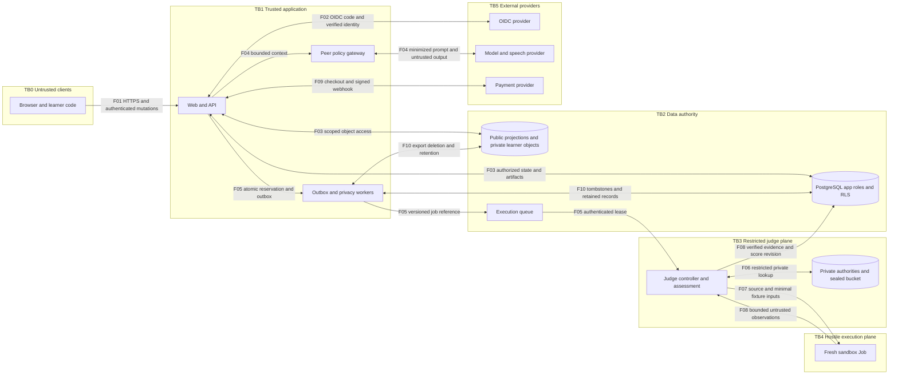
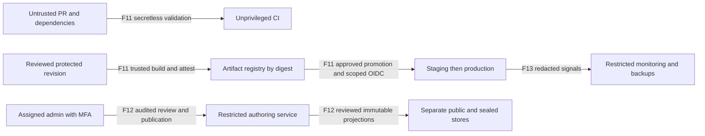

# Data flows and trust boundaries

All nodes are proposed. Arrows identify data movement, not implicit authorization. Flow IDs map to the [threat register](threats.md).

| Flow | Contract at receiver | Denial or failure behavior |
|---|---|---|
| F01 | Validate schema, origin/CSRF, session, ownership, stage, revision and idempotency; authorize SSE/WS replay and reconnect | Reject forged/expired identity; disconnect revoked streams; no mutation on conflict |
| F02 | Verify issuer, audience, signature, expiry, state, nonce, redirect allowlist and PKCE where applicable; no email-only implicit account linking | Reject callback replay and wrong issuer; recent authentication for sensitive operations |
| F03 | Separate nonowner/non-BYPASSRLS app role; FORCE RLS; authorize every object and field; no shared private response cache | Reject missing context and foreign parent; clear context on pooled connection return |
| F04 | Server-selected context and tools; exclude sealed cases, expected outputs and credentials; constrain provider destination | Treat comments/model requests as data; reject unauthorized tool calls; save reasoning during provider outage |
| F05 | DB reservation/outbox atomically persist principal, tenant, submission hash, version and job ID; authenticate service calls | No dispatch without committed reservation; duplicate deliveries reuse job ID; fence leases |
| F06 | Separate DB pool, service identity, sealed storage IAM and KMS access limited to controller | App/peer direct query and storage access denied; no credential relay to runner |
| F07 | Read-only bounded projection with necessary inputs only; no private oracle, expected output, workload token or arbitrary image | Admission rejects missing sandbox policy; network/metadata denied; kill switch stops admissions |
| F08 | Validate schema/size, source hash, run ID and lease epoch; external oracle comparison; escape traces and stdio | Ignore candidate passed flags; reject stale results; truncate explicitly; never invoke arbitrary repr/getters |
| F09 | Server amount/currency; raw-body signature verification before processing; deduplicate and reconcile ledger transaction | Invalid signature changes nothing; duplicate/out-of-order callbacks cannot duplicate credit |
| F10 | Recent authentication; owner-bound asynchronous export; short-lived link; deletion tombstones across stores/backups/providers | Revoke access immediately; retry idempotently; do not announce full deletion before all required stores acknowledge |
| F11 | PR has no secrets; reviewed build pins deps/actions/images; protected OIDC subject/ref/environment; same tested digest promoted | Deny fork/ref escalation, leaked secrets and wrong digest; no rebuild during promotion |
| F12 | MFA, explicit case/result assignment, two distinct reviews and immutable publication | Tenant admins gain no transcript privilege; no self-approved publication or overwrite |
| F13 | Content-free observability by default; restricted audit access; encrypted backup and isolated restore | Alert on denied reads, spend/queue growth and purge failure; replay tombstones before restored service opens |

The controller may read private authority; a runner may receive only necessary fixture inputs. Such inputs are visible to hostile code and cannot be promised secret. Private oracle code and expected results must never be mounted wholesale.
